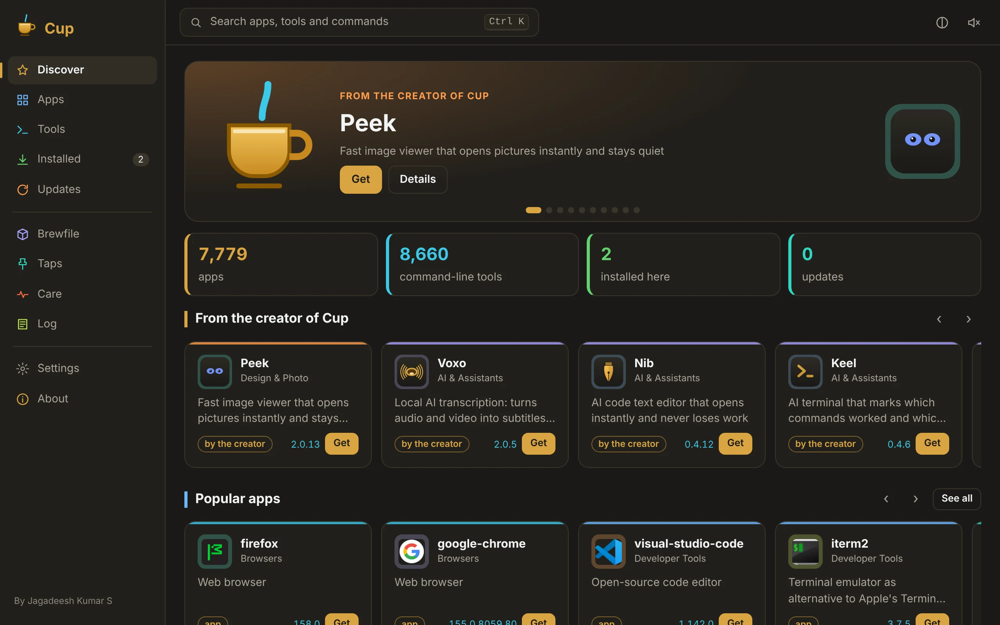
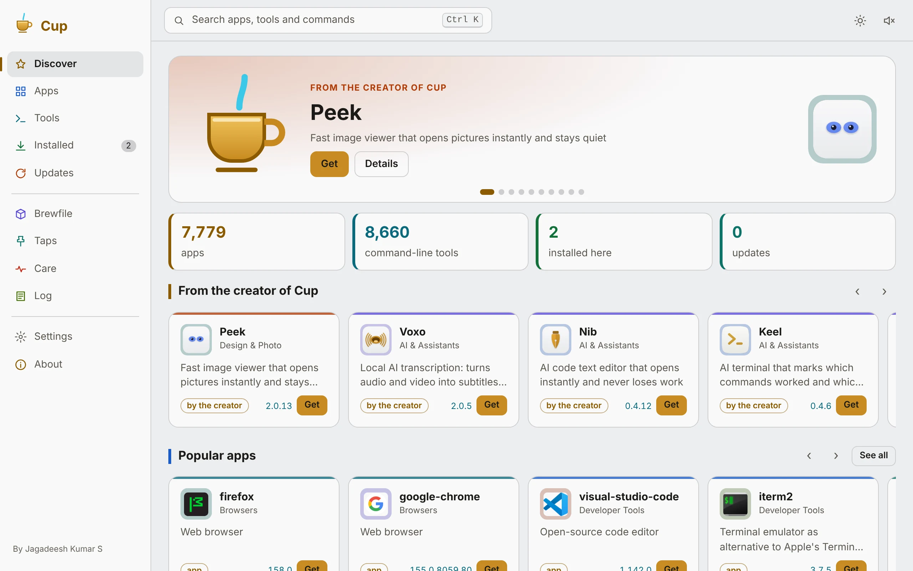
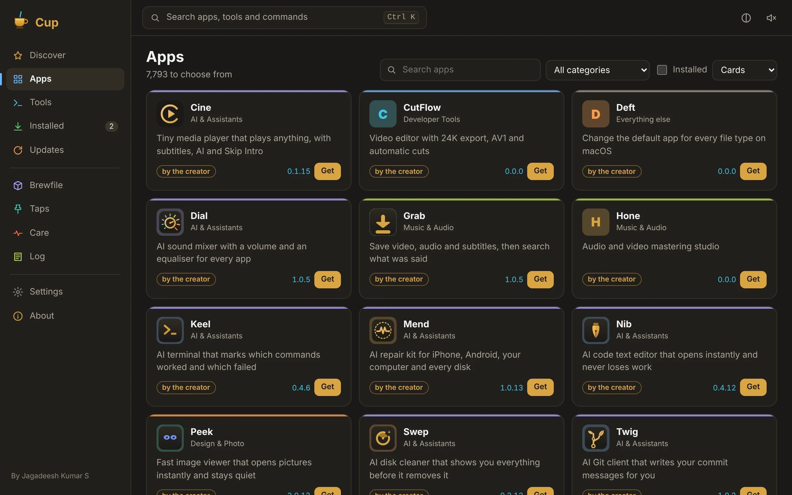
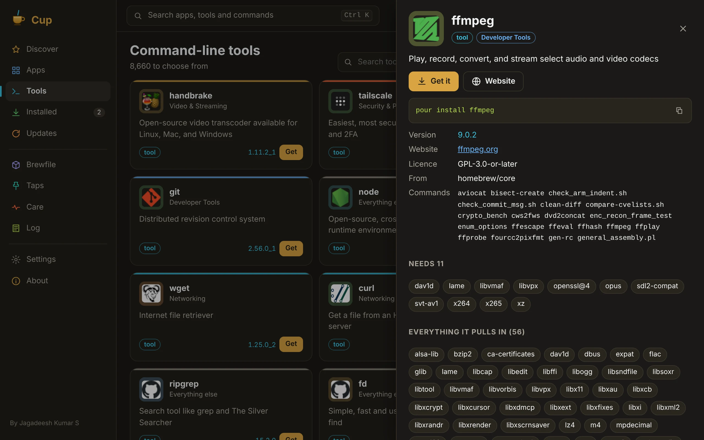
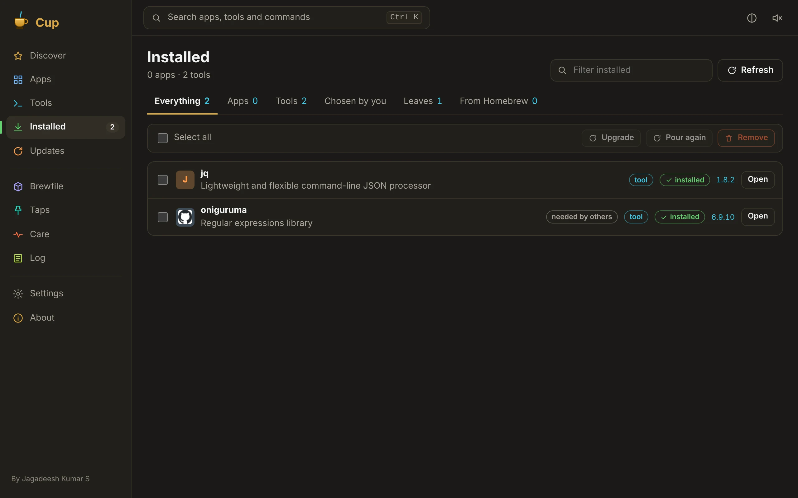
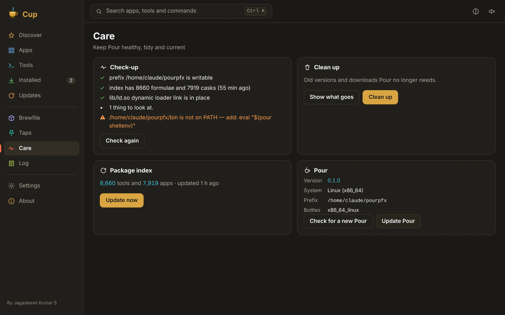
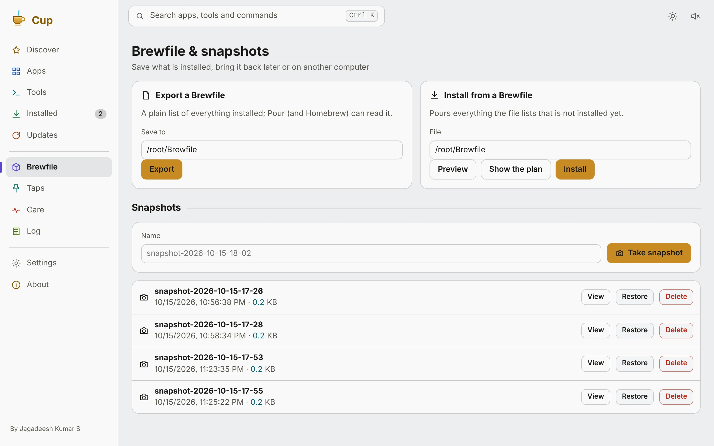

  <picture>
    <source media="(prefers-color-scheme: dark)" srcset="docs/cup-dark.svg">
    
  </picture>

<h1 align="center">Cup</h1>

<b>The tiny app store for the Pour package manager.</b> 
Find, install, update and tidy apps and command-line tools in one window, with no terminal needed. It's under 1 MB.

⭐ <b>If Cup is useful to you, please star this repository.</b> Stars help other people find it. ⭐

  
   <a href="docs/demo.mp4">▶ Watch the demo with sound (MP4)</a>

## Install

Cup installs with **Pour**. Install Pour once, then Cup:

| System | Command |
| --- | --- |
| **macOS** (Apple silicon and Intel) | `curl -fsSL https://ipconfig.co.network/pour/install \| sh && pour install --cask cup` |
| **Linux** (x86_64 and arm64, .deb or tarball) | `curl -fsSL https://ipconfig.co.network/pour/install \| sh && pour install --cask cup` |
| **Windows** 10/11 (x64) | Download [`pour-windows-x86_64.exe`](https://ipconfig.co.network/pour/dl/pour-windows-x86_64.exe), then `pour install --cask cup` |
| **FreeBSD** 14 (x86_64) | `pkg install webkit2-gtk_41 gtk3`, then `curl -fsSL https://ipconfig.co.network/pour/install \| sh && pour install --cask cup` |
| **ChromeOS** (Linux development environment) | same as Linux |

If Pour isn't on your computer yet, Cup offers to install it on first launch.

> Every download is also on the [Releases](https://github.com/JKS-sys/cup-15-Oct-2026/releases) page: `.dmg` and `.app.tar.gz` for macOS, a per-user installer and a portable `.zip` for Windows, `.deb` and `.tar.gz` for Linux, and `.tar.gz` for FreeBSD.
> On macOS without notarisation, the first launch may need `xattr -cr /Applications/Cup.app`.

## What it does

**Discover.** Browse shelves of the creator's own apps, popular apps and tools, and 17 categories (AI, developer tools, browsers, design, music, video, security, networking, fonts and more). A featured pick rotates at the top. You can search Pour's whole catalogue of about 16,000 apps and tools instantly.

**Install, update, remove.** Each app and tool has a details sheet with its version, website, licence, what it puts in Applications, the commands it adds, what it needs and what needs it, plus its notes. You can get it, update it, pour it again, pin, link or remove it (with **zap** for apps). Each one also shows its `pour install` line, ready to copy.

**Installed.** See everything installed, separated into apps, tools, the ones you chose yourself, and **leaves** (tools nothing else needs). Shift-click selects a range and you can act on many at once. Cup also shows what **Homebrew** put on your computer and moves it all to Pour in one step, after showing you the plan.

**Updates.** Cup checks in the background on a schedule you choose and badges the Dock icon when updates are waiting. Upgrade one app or everything, optionally including apps that update themselves, and Cup can clean up afterwards.

**Brewfile and snapshots.** Export what you have, preview a Brewfile, see its plan, then install from it. Snapshots are named Brewfiles Cup keeps for you, which you can view, restore or delete.

**Taps.** Add and remove extra registries.

**Care.** This tab runs a check-up, previews a clean-up before cleaning, updates the index, and shows Pour's own version with a button to update Pour itself.

**Log.** Every command runs live in a log box with a status, timings, a badge on each line (step, done, warning, error), counts, Copy and Stop.

**Small touches.** ⌘K searches everything (pages, actions, packages). There are right-click menus everywhere, keyboard shortcuts and eight layouts (cards, list, compact, tiles, magazine, masonry, board, timeline). Themes are light, dark or automatic, with no pink anywhere. Synthesised sounds (eight packs, no audio files) each come with a small self-drawing picture. There's a start-up animation, and animations can be Off, Subtle or Lively.

   
   
   
  

## Why it is so small

Cup isn't a bundled browser. It draws its window with the WebView already on your computer: WebKit on macOS, WebKitGTK on Linux and FreeBSD, and Microsoft Edge WebView2 on Windows. Around that is a small native program, and the interface is packed inside it. The program is about **0.6 to 0.8 MB** on each system.

Haiku has no system WebView that a desktop window can use, so there is no Haiku build.

## Privacy

If you leave it switched on, Cup sends one anonymous hello a day (app name, version, system and a random id) and short crash notes to its creator's dashboard. It never sends what you install. Package icons come from the packages' own websites through Google's favicon service, and you can switch them off in Settings.

## Building (owner)

`bash update.sh` does everything on the owner's Mac:

- installs its tools with Pour
- picks the next version
- builds and seals the interface, then runs the tests: Rust units, plus an end-to-end test that installs and removes a real package through Pour, checks every page in both themes and checks sizes from 420×260 to 1600×1000 for zero page errors
- builds macOS (both chips), Windows, Linux (both chips, in Docker) and FreeBSD
- writes `latest.json` and checksums
- publishes this repository and its release
- mirrors the release to the R2 bucket `cup-15-oct-2026`
- registers Cup with Pour

<!-- licence -->
## Licence

**© 2026 Jagadeesh Kumar S. All rights reserved.**

Cup is **free for personal use**. The source is published so you can read it, but you **may not copy it**, in whole or in part, or modify, rebrand or redistribute it. Only its owner publishes builds. The full text is in [LICENSE](LICENSE).
<!-- /licence -->

## The creator

**Jagadeesh Kumar S** is a creator. He builds the Pour package manager and a family of small, fast apps, and presents *NewsCraft World Report* on the [NewsCraft Studio](https://www.youtube.com/@JKS-sys) YouTube channel: calm, careful news on world politics, business, tech and AI, science, climate and health.
✉️ JKS.sys@icloud.com · 📍 Velachery, Chennai, India · 💛 [Sponsor](https://razorpay.me/@NSBJKS)

 

⭐ <b>Thank you for reading. If Cup helps you, please star this repository.</b> ⭐

